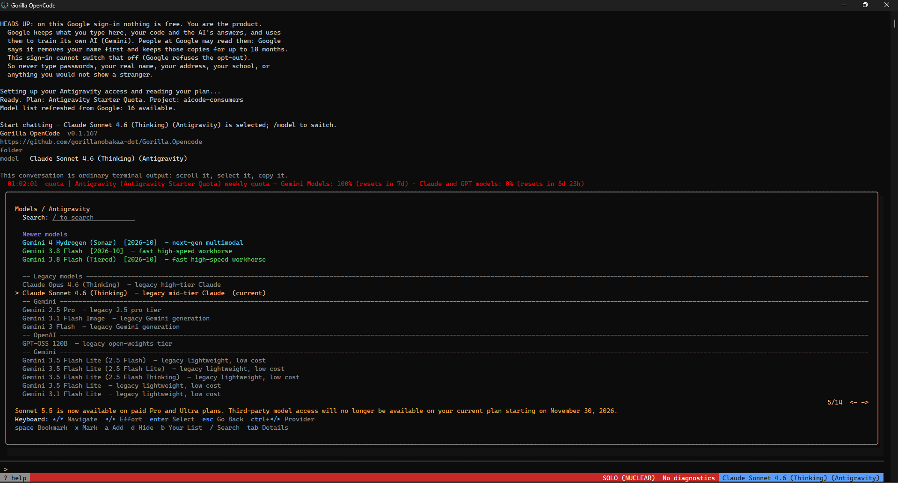
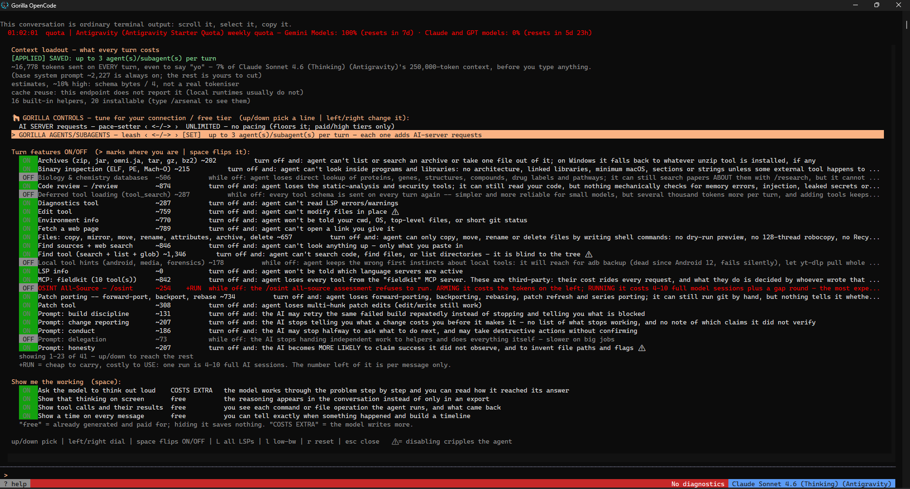
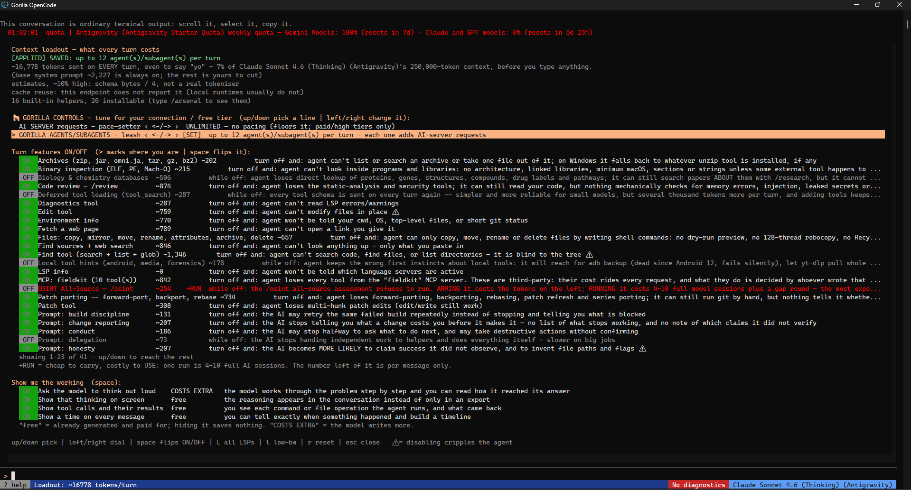
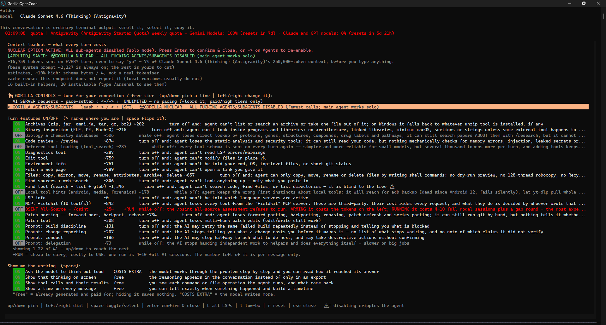

# In plain language

## What this is

A quick hotfix release for `0.1.167` that fixes the `Enter` key inside `/context`
so pressing `Enter` locks in your agent limit or Nuclear Option and closes the
menu instead of knocking the dial one step to the right.

## Should you download it?

Yes — especially if you use `/context` to set a sub-agent cap or turn on
**Gorilla Nuclear Option** (solo mode).

## Why this matters

- **`Enter` now cements your choices and closes `/context`:** Move the top
  dials (AI request pace and agent/sub-agent cap) with `←` and `→`, flip any
  feature `ON`/`OFF` with `Space` (pressing `Space` on a dial also holds its
  current setting instead of nudging it), and press **`Enter`** to confirm,
  save, and close the screen.
- **Nuclear Option stays locked on:** Dialing left to
  `GORILLA NUCLEAR — ALL FUCKING AGENTS/SUBAGENTS DISABLED` and pressing
  `Enter` now closes `/context`, shows a clear confirmation toast, and keeps
  the red `SOLO (NUCLEAR)` indicator active in the bottom bar.
- **Clear on-screen key guide:** The bottom help line in `/context` now reads
  `up/down pick | left/right dial | space toggle/select | enter confirm & close | ... | esc close`.

## What you are looking at (Screenshots)

### 1. Tiered `/model` picker with Newer vs Legacy models & vendor dividers

- **What you are seeing:** The `/model` picker after the `0.1.167`/`0.1.168`
  reorganization. The newest generation models sit at the top under
  **Newer models** with color coding, `[YYYY-MM]` launch dates, and short plain
  descriptions (such as `next-gen multimodal` and `fast high-speed workhorse`).
  Older models sit below a clear **`-- Legacy models --`** divider, split by
  vendor (`-- Gemini --`, `-- OpenAI --`) so you never confuse an older model
  with a current flagship. Notice the red **`SOLO (NUCLEAR)`** pill at the
  bottom right showing Nuclear Option is active while you browse models.

### 2. Setting a 3-agent cap in `/context` with instant confirmation

- **What you are seeing:** The `/context` menu when you dial the
  **GORILLA AGENTS/SUBAGENTS** limit to **3 agents per turn** using `←`/`→`.
  Two clear confirmations prove the limit actually took effect: the inline
  **`[SET]`** tag directly on the highlighted orange bar, and the green
  **`[APPLIED] SAVED: up to 3 agent(s)/subagent(s) per turn`** banner near the
  top of the screen. Press **`Enter`** to hold it in place and close.

### 3. Raising the cap to 12 agents/subagents in `/context`

- **What you are seeing:** The same `/context` menu dialed up to **12
  agents/subagents per turn** for heavier parallel jobs. The green
  **`[APPLIED] SAVED`** banner at the top updates immediately, the blue bottom
  status bar shows the exact per-turn prompt overhead (`Loadout: ~16778
  tokens/turn`), and every feature row below tells you in plain English what
  turning it off saves and what stops working.

### 4. Gorilla Nuclear Option active — Before (`0.1.167`) vs After (`0.1.168`)

**Before (`0.1.167` — before `Enter` confirmed and closed `/context`):**

**After (`0.1.168` — `Enter` confirms, locks Nuclear Option in place, and closes `/context`):**

- **What you are seeing:** **Gorilla Nuclear Option** turned on (dial all the
  way left with `←`, then press **`Enter`** to confirm and close). Comparing
  **Before** vs **After**:
  1. The bright red top banner now says **`NUCLEAR OPTION ACTIVE: ALL sub-agents disabled (solo mode). Press Enter to confirm & close, or -> on Agents to re-enable.`**
  2. The green **`[APPLIED] SAVED: GORILLA NUCLEAR`** confirmation and inline
     **`[SET]`** tag stay locked on when you press `Space` or `Enter`.
  3. The bottom key bar now explicitly shows **`enter confirm & close`** and
     **`space toggle/select`** (instead of the old `space flips ON/OFF | ... | esc close`),
     and pressing `Enter` closes `/context` while keeping the red **`SOLO (NUCLEAR)`**
     mode active.

## What was checked

See the release evidence for GitHub CI results across Linux and Windows and
reproducible multi-platform builds (Windows, Linux, and macOS).
