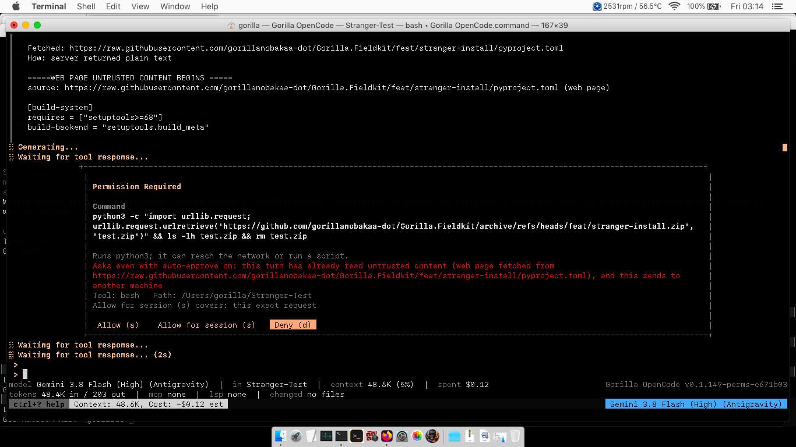
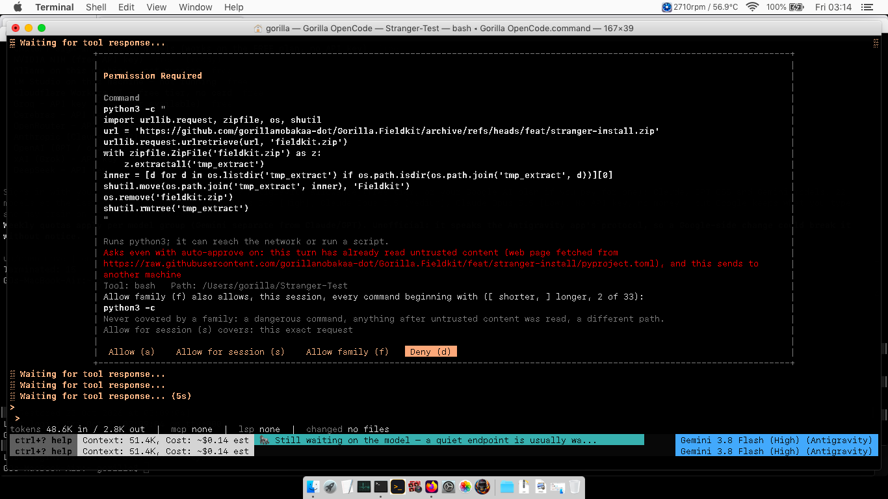
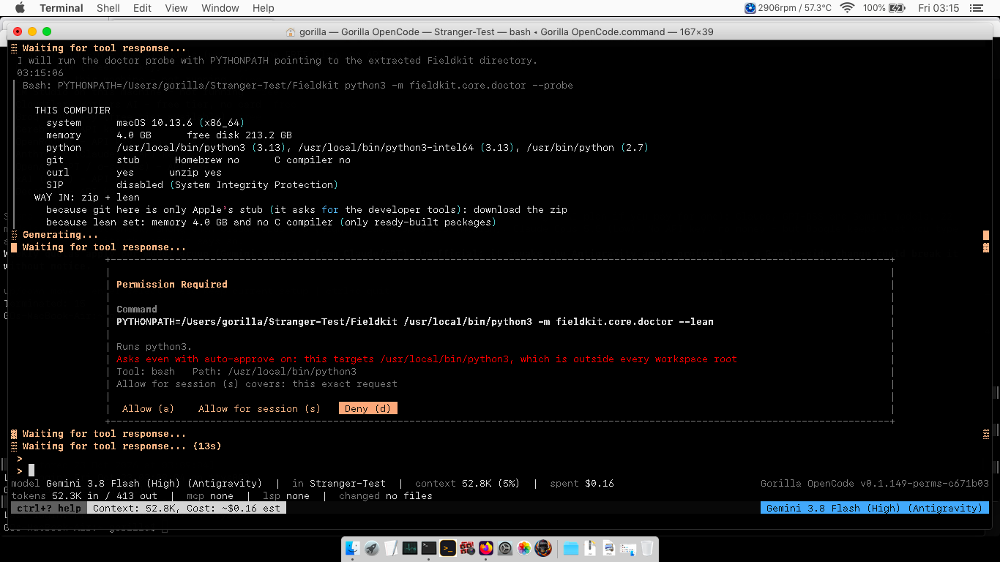

<!-- Version: 1.2.0 · updated 26-10-23-03-30 -->
# When the assistant asks before acting, and when it does not (2026-10-23 rework)

*Two tracks, both complete. Claims are marked `stated in input` (measured or
reported, with the source) or `model inference` (reasoning not measured).*

---

## Plain-language track

### What went wrong

On 23 October 2026 the owner tested the program on a 2011 MacBook Air, playing a
stranger installing Fieldkit, with "auto-approve" switched on. Auto-approve is the
setting that means "do not keep asking me". The program still stopped four times
with a security question (`stated in input`, the plan's evidence table):

1. when it looked inside a system folder to see if Apple's developer tools were
   installed;
2. when it read the project's README page on GitHub;
3. when it read a second page on the same site;
4. when it asked Python and Git for their version numbers.

None of those can change or send anything. Worse, every question box showed the
word "Command" or "URL" with **nothing under it**: the box was too small and the
warning text above pushed the one thing you need to judge out of sight. And when
the owner pressed "Deny" once, the work stopped dead instead of carrying on.

A question you cannot read trains you to press "Allow" without reading. That is
less safe, not more.

### What changed

- **Looking never asks.** Reading files anywhere you can read them, listing
  folders, `--version`, `which`, `git status` and similar run without a question,
  with or without auto-approve. Credential files (SSH keys, cloud passwords, this
  program's own keys) are still not read without asking.
- **Auto-approve stops only for two kinds of thing**: what cannot be undone or
  touches the whole machine (deleting a disk, `sudo`, installing software for the
  whole computer, writing outside your project folders), and what could carry
  your data away (after the assistant has read a web page, sending anything to a
  site it has not used yet in this conversation, or a command whose job is to
  send to another machine, such as `scp`, `ssh` or `git push`). Running Python or
  Fieldkit inside your folder does not ask, and nor does installing into the
  project's own `.venv`.
- **Every question box shows the full command or web address first**, then one
  plain line saying what it does, then why it is asking.
- **"Deny" is an answer.** The assistant is told "the person said no, do not try
  again, carry on another way or ask in writing", and keeps working.
- **"Allow for session" says what it covers and remembers a kind of action in a
  place**, for example "every `pip3 install` command in Stranger-Test" or "every
  file change inside Stranger-Test", instead of one exact line typed once.

### What was not checked

The new behaviour is proven by automated tests on Linux, and was run once on the
MacBook Air (run 3 below, with screenshots): the same install asked 4 times
instead of 33. One of the 4 was a fault, fixed after that run; the fix has not
been tried on the Air yet. "Deny" was not tried on the Air: the model refused the
risky step by itself and never asked.

---

## Developer track

### Evidence (stated in input: PERMISSIONS-REWORK-PLAN.md, measured 2026-10-23)

v0.1.149-dev, macOS 10.13, Gemini 3.8 Flash High, auto-approve ON:

| # | Tool | What it did | Reason printed | Field shown |
|---|---|---|---|---|
| 1 | bash | probe `/Library/Developer/CommandLineTools` | outside every workspace root | `Command` empty |
| 2 | web_fetch | README on GitHub | sends a request off the machine | `URL` empty |
| 3 | web_fetch | INSTALL.md, same site | already read untrusted content | `URL` empty |
| 4 | bash | `python3 --version && git --version` | already read untrusted content | `Command` empty |

### Causes found (each reproduced by a test before the fix)

- **Empty field**: `dialog/permission.go` sized the box at 40% of the window and
  gave the command viewport `height - header - buttons - title - 2`. With the
  auto-approve banner (a long reason wraps to 3-4 rows) the viewport height was
  zero or negative. Reproduced at 80x24, 100x30, and for a URL even at 160x45
  (`TestTheDialogShowsTheCommandAndURLInFull` failed 5 of 6 cases before the fix).
- **Row 1**: `2>/dev/null` contains `>`, which `opaqueConstructs` treats as a
  write, so the line lost read-only standing; `bashRequestPath` then found
  `/Library/...` outside the roots and the carve-out fired (`model inference` as
  to the exact command the model sent: the test uses the probe forms a model
  writes, `ls ... 2>/dev/null`, `test -d ... && echo yes`, `xcode-select -p`).
- **Rows 2, 3**: `mustAskAnyway` asked for every `Egress` request under
  auto-approve, tainted or not.
- **Row 4**: `python3` was not on `safeReadOnlyCommands`, and after any web read
  `mustAskAnyway` asked for every non-edit tool.
- **Deny freeze**: `agent.go` finished the assistant message with
  `FinishReasonPermissionDenied` on any `ErrorPermissionDenied`, ending the turn.

### Each relaxed rule: the fear it answered, and what still answers it

| Relaxed rule | Earlier fear (source) | What still covers it |
|---|---|---|
| Every egress asks under auto-approve | A poisoned page steers the model to send data to the attacker's server (carveout_test.go, 2026-08-19; taint.go) | After untrusted content, a destination this conversation has not used asks (`knownEgress`). The attacker's host is by definition new. A host already used was chosen before the poison, by the person or the first read. |
| Taint makes every non-edit tool ask | "a shell command can do anything" (decision B comment, 2026-10-11) | For bash, taint asks only when the command explicitly sends to another machine (`tools.MayReachNetwork`): a sender program (ssh, scp, rsync, sftp, gh, aws, open...), a remote git subcommand, an image push, a `user@host:` target, any `://`, or inline `-c`/`-e` code naming a network library. Other non-edit tools keep the old rule unchanged. |
| `>` disqualifies read-only | Redirection writes a file (commandgate.go, 2026-08-18) | Only `>/dev/null`, `2>/dev/null`, `&>/dev/null`, `2>&1`, `2>$null` are removed before analysis; any other `>` still disqualifies. The regex needs a word boundary, so `/dev/nullx` is not stripped. |
| `cat`, `head`, `grep`, `find`, `rg`, `type` (bash) and more now read-only | Reading credentials into the transcript (sensitive.go, 2026-08-18); `type` = Get-Content in PowerShell (2026-10-05) | `namesSensitivePath` runs `RefuseSensitiveRead` on every path word and refuses `/proc/*/environ`; the after-tool secret mask still masks keys and private-key blocks; `type` is added only when the shell is not PowerShell. `find -delete/-exec/-ok/-fprint*`, `rg --pre` are in `unsafeFlags`. |
| `<program> --version` is read-only | An arbitrary program runs (2026-08-18: wrappers like `timeout` hide the real command) | Exactly two words, second in `{--version, -version, --help, version}`, program without a path (so not a file the model just wrote). Wrappers are not affected: `timeout 5 curl` is three words. |
| Reads outside the roots ask | "Auto-approve is not consent to touch ~/.ssh" (carve-out 2) | Reads were never requests for `view`; for the shell, read-only commands never reach the carve-out, and the credential guard covers the ~/.ssh case. Writes, deletes and non-read-only commands naming an outside path still ask. |
| "Allow for session" covers one exact string | `cat README.md` authorising every later bash command (2026-08-18, b333c23) | The class is `SuggestCommandFamily(cmd, nil)` (program and bare subcommand), recorded as a family: plain tail only (no chaining, redirection, substitution), same place, never irreversible, never egress, never in a tainted turn. The dialog prints the class and place before the answer. Edits: same root only. |
| A Deny ends the turn | Calls sent with a refused one ran anyway (2026-10-05, `goto out`) | The other calls in the same message are still not run; only the person's own Deny continues (`TakePersonDenial`). A timeout, a closed stdin or an editor that went away (`Refuse`) still ends the turn. |

New hard stops (they ran unasked before whenever the turn was untainted):
`HardStopIn` asks under auto-approve for sudo/doas/su/pkexec/runas, brew/port/
apt/apt-get/dnf/yum/pacman/zypper/snap/flatpak installs, `dpkg -i`, `installer`,
`softwareupdate`, `xcode-select --install`, pip installs without `--user`/
`--target`/`--prefix`, `npm -g`, `gem install` without `--user-install`,
`cargo install`. Unattended (`-p`) logs and proceeds, as the egress carve-out did.

### Run 2, and why the first version of the shell rule was replaced the same night

`stated in input` (PERMISSIONS-REWORK-PLAN.md, "Evidence, run 2", relayed by the
coordinating session): one successful install on the Air cost 33 dialogs with
auto-approve on, 26 of them one per bash command, every command inside
~/Stranger-Test (`python3 -m fieldkit...`, `.venv/bin/fieldkit ...`,
`.venv/bin/python -m pip install pytest`), 13 with the Command field empty.

The first commit of this rework (b9d3648) made taint ask for any shell command
not on a table of local programs. Every one of those 26 runs Python, so all of
them would still have asked. Replaced by the senders table above; venv and
in-project pip installs are not a hard stop (`projectLocalProgram`).
`TestTheMacBookAirRun2RaisesNoDialog` holds the 13 visible rows: 13 dialogs
under the old taint rule (mutation run, this session), 0 now.

`stated in input` (the owner, 2026-10-23, relayed): the over-cautious rules were
insisted on by an earlier model against the owner's wishes; they are not settled
decisions. The owner's reference is Claude Code's model: read-only tools never
ask, even outside the project; "don't ask again" remembers a prefix or a domain;
the prompt shows the full command; no blanket taint; a denial returns to the
model. This rework matches each of those. Two differences remain on purpose, both
named in the plan: auto-approve still stops for the hard stops, and for an
explicit network send to a new place after untrusted content.

### Run 3: the rework on the Air (2026-10-23 03:12-03:22)

`stated in input` (the coordinating session, from the Air): build
v0.1.149-perms-c671b03 for macOS 10.13, auto-approve on, the same stranger
install from an empty ~/Stranger-Test. Fieldkit installed and ran. **4 dialogs
for the whole install** (run 2: 33). Each showed the full command or URL and
the plain line; the border was aligned and the rows around the box were intact.

| # | Request | Why it asked | Verdict |
|---|---|---|---|
| 1 | web_fetch raw.githubusercontent.com/.../INSTALL.md | a host not used yet, after github.com was read | the rule as written; GitHub's own content host (see follow-up) |
| 2 | `python3 -c` urllib download of the branch zip | inline code naming urllib, after untrusted content | the rule as written |
| 3 | `python3 -c` download and unzip | same | the rule as written |
| 4 | `PYTHONPATH=... /usr/local/bin/python3 -m fieldkit.core.doctor --lean` | "targets /usr/local/bin/python3, outside every workspace root" | **a fault**: the program being run was taken for a place being touched, because only word 0 was skipped and word 0 was `PYTHONPATH=...`. Fixed in `bashRequestPath`; row added to `TestTheMacBookAirRun2RaisesNoDialog` (fails on the old rule). |

Deny was not tested live: asked to run `sudo -n true` and `brew install ripgrep`,
the model refused on its own (the task's rules forbid sudo), wrote the question
to QUESTIONS.txt and never called the tool. `TestAPersonsDenyIsAnAnswerAndTheTurnCarriesOn`
remains the evidence until a run where the model does call it.

### Tests

- `internal/llm/tools/commandclass_test.go`: a subtest per read-only row
  (`TestReadOnlyCommandsNeverAsk`), per must-ask row (`TestTheseStillAsk`), hard
  stops, network rows, and the evidence table (`TestTheMacBookAirEvidenceRaisesNoDialog`,
  0 dialogs), run 2 (`TestTheMacBookAirRun2RaisesNoDialog`, 0 dialogs), plus
  `TestTheStrangerTaskStillStopsWhereItShould` (7 dialogs).
- `internal/tui/components/dialog/permission_content_test.go`: command and URL
  shown in full at 80x24, 100x30, 160x45; no row wider or taller than the window;
  a grant button never without its sentence.
- `internal/llm/agent/person_deny_test.go`: a Deny reaches the model through the
  real turn loop and the turn ends on the model's answer.
- `internal/permission/grantscope_test.go`: class plus place.

Mutations run (each restored after): old egress rule, old taint rule, no redirect
stripping, no version rule, no sensitive-path check, no hard stop, no
`localPrograms` check, no person-deny branch, no session class, no edit-root
match. Every one made at least one test fail (`stated in input`: this session's
run, 2026-10-23).

### Not verified

- Run on macOS: done once (run 3 above), before the dialog-4 fix; the fix itself
  is tested on Linux only. Deny not exercised live.
- `MayReachNetwork` is a table of senders, not an analysis. A script FILE that
  opens a socket (`python3 send.py`) is not read, so after untrusted content it
  runs under auto-approve. Residual risk, stated rather than hidden, and taken on
  purpose: see "Run 2" below. Claude Code, the owner's reference, has no taint
  at all, so this is still stricter than the reference.
