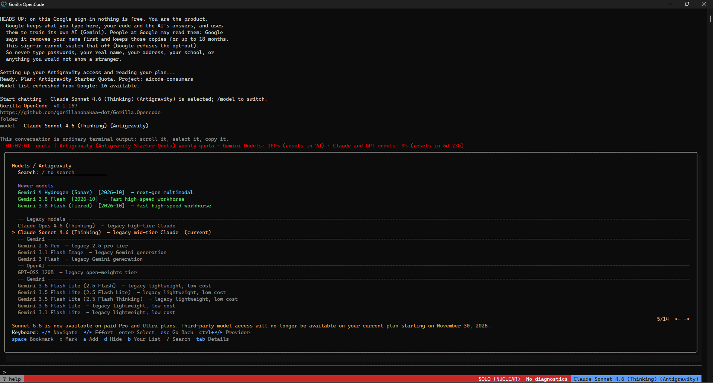

# Gorilla OpenCode 0.1.168: Enter confirms and saves in /context (Nuclear Option fix)

## What is this program?

Gorilla OpenCode is a terminal coding assistant. It uses the models and
connections you choose, including models running on your computer.

## Should you download this version?

Yes. Update from `0.1.167` immediately if you use `/context` to set an agent
limit or turn on Nuclear Option (solo mode).

## Why this matters to you

In `0.1.167`, pressing `Enter` inside `/context` after sliding the Agents dial
to **Nuclear Option** accidentally bumped the dial one step to the right and
turned Nuclear Option back off. Now **`Enter` confirms and closes `/context`**
while locking every setting (including Nuclear Option) in place, matching how
`Enter` works everywhere else in Gorilla OpenCode. This release page also adds
annotated screenshots showing the new tiered `/model` picker and `/context`
agent-limit and Nuclear Option confirmations.

---
# In plain language: everything in this release

This is the complete explanation, not a summary of one. Nothing below is behind a link.

<!-- plain-language track: in full, on this page -->

### What this is

A quick hotfix release for `0.1.167` that fixes the `Enter` key inside `/context`
so pressing `Enter` locks in your agent limit or Nuclear Option and closes the
menu instead of knocking the dial one step to the right.

### Should you download it?

Yes — especially if you use `/context` to set a sub-agent cap or turn on
**Gorilla Nuclear Option** (solo mode).

### Why this matters

- **`Enter` now cements your choices and closes `/context`:** Move the top
  dials (AI request pace and agent/sub-agent cap) with `←` and `→`, flip any
  feature `ON`/`OFF` with `Space` (pressing `Space` on a dial also holds its
  current setting instead of nudging it), and press **`Enter`** to confirm,
  save, and close the screen.
- **Nuclear Option stays locked on:** Dialing left to
  `GORILLA NUCLEAR — ALL FUCKING AGENTS/SUBAGENTS DISABLED` and pressing
  `Enter` now closes `/context`, shows a clear confirmation toast, and keeps
  the red `SOLO (NUCLEAR)` indicator active in the bottom bar.
- **Clear on-screen key guide:** The bottom help line in `/context` now reads
  `up/down pick | left/right dial | space toggle/select | enter confirm & close | ... | esc close`.

### What you are looking at (Screenshots)

#### 1. Tiered `/model` picker with Newer vs Legacy models & vendor dividers

- **What you are seeing:** The `/model` picker after the `0.1.167`/`0.1.168`
  reorganization. The newest generation models sit at the top under
  **Newer models** with color coding, `[YYYY-MM]` launch dates, and short plain
  descriptions (such as `next-gen multimodal` and `fast high-speed workhorse`).
  Older models sit below a clear **`-- Legacy models --`** divider, split by
  vendor (`-- Gemini --`, `-- OpenAI --`) so you never confuse an older model
  with a current flagship. Notice the red **`SOLO (NUCLEAR)`** pill at the
  bottom right showing Nuclear Option is active while you browse models.

#### 2. Setting a 3-agent cap in `/context` with instant confirmation

[![Context loadout dialog with the Agents/Subagents dial set to up to 3 agents per turn, showing the inline [SET] badge and green [APPLIED] SAVED confirmation banner at the top](https://raw.githubusercontent.com/gorillanobakaa-dot/Gorilla.Opencode/v0.1.168/docs/screenshots/gallery/v0168-context-agents-3.png)](https://raw.githubusercontent.com/gorillanobakaa-dot/Gorilla.Opencode/v0.1.168/docs/screenshots/gallery/v0168-context-agents-3.png)

- **What you are seeing:** The `/context` menu when you dial the
  **GORILLA AGENTS/SUBAGENTS** limit to **3 agents per turn** using `←`/`→`.
  Two clear confirmations prove the limit actually took effect: the inline
  **`[SET]`** tag directly on the highlighted orange bar, and the green
  **`[APPLIED] SAVED: up to 3 agent(s)/subagent(s) per turn`** banner near the
  top of the screen. Press **`Enter`** to hold it in place and close.

#### 3. Raising the cap to 12 agents/subagents in `/context`

[![Context loadout dialog dialed up to 12 agents/subagents per turn with [SET] inline tag, green [APPLIED] SAVED banner, and live per-turn token count in the bottom bar](https://raw.githubusercontent.com/gorillanobakaa-dot/Gorilla.Opencode/v0.1.168/docs/screenshots/gallery/v0168-context-agents-12.png)](https://raw.githubusercontent.com/gorillanobakaa-dot/Gorilla.Opencode/v0.1.168/docs/screenshots/gallery/v0168-context-agents-12.png)

- **What you are seeing:** The same `/context` menu dialed up to **12
  agents/subagents per turn** for heavier parallel jobs. The green
  **`[APPLIED] SAVED`** banner at the top updates immediately, the blue bottom
  status bar shows the exact per-turn prompt overhead (`Loadout: ~16778
  tokens/turn`), and every feature row below tells you in plain English what
  turning it off saves and what stops working.

#### 4. Gorilla Nuclear Option active (zero sub-agents, solo mode)

[![Context loadout dialog with Gorilla Nuclear Option enabled, displaying the red NUCLEAR OPTION ACTIVE warning banner, green [APPLIED] SAVED Nuclear confirmation, inline [SET] tag, and red SOLO (NUCLEAR) badge in the status bar](https://raw.githubusercontent.com/gorillanobakaa-dot/Gorilla.Opencode/v0.1.168/docs/screenshots/gallery/v0168-context-nuclear-option.png)](https://raw.githubusercontent.com/gorillanobakaa-dot/Gorilla.Opencode/v0.1.168/docs/screenshots/gallery/v0168-context-nuclear-option.png)

- **What you are seeing:** **Gorilla Nuclear Option** turned on (dial all the
  way left with `←`, then press **`Enter`** to confirm and close). You get
  three unmistakable signals that no background sub-agents can spawn:
  1. The bright red **`NUCLEAR OPTION ACTIVE: ALL sub-agents disabled (solo mode)`**
     banner at the top.
  2. The green **`[APPLIED] SAVED: GORILLA NUCLEAR`** confirmation and inline
     **`[SET]`** tag on the highlighted row.
  3. The persistent red **`SOLO (NUCLEAR)`** badge on the bottom status bar so
     you always know solo mode is locked on even after closing `/context`.

### What was checked

See the release evidence for GitHub CI results across Linux and Windows and
reproducible multi-platform builds (Windows, Linux, and macOS).

---

# For developers: how it works, and how to check it

Written for someone who will audit, fork or change the code. It covers the same release as the plain-language part above; neither is a summary of the other.

<!-- developer track: in full, on this page -->

### Summary

Fixes the `/context` loadout dialog key-binding regression discovered on live
`v0.1.167` usage (`internal/tui/components/dialog/loadout.go`):

- Split `loadoutKeys.Confirm` (`"enter"`) out of `loadoutKeys.Toggle` (`" "`).
  Previously `Toggle` matched both Space and Enter and called
  `m.adjustSelected(+1)` on dial rows (`rowPace`, `rowLeash`), so dialing left
  to Nuclear Option (`config.SubAgentsNuclear == 0`) and pressing `Enter` to
  save/close silently stepped `MaxSubAgents` right to `1`.
- Pressing `Enter` anywhere in `/context` now preserves every active dial and
  toggle value untouched, emits `LoadoutChangedMsg`, a confirmation info toast
  (`Saved: NUCLEAR OPTION ACTIVE — main agent works solo` when Nuclear is set),
  and `CloseLoadoutDialogMsg`.
- Pressing `Space` on dial rows (`rowPace`, `rowLeash`) records `[SET]` /
  `[APPLIED]` confirmation without altering the dial value; `Space` on feature
  and display rows continues to toggle `ON`/`OFF`.
- Updated the `/context` footer help line and Nuclear Option banner copy to
  advertise `enter confirm & close`.
- Added 4 privacy-scrubbed screenshots under `docs/screenshots/gallery/v0168-*.png`
  illustrating the tiered `/model` picker, 3-agent and 12-agent caps, and
  Nuclear Option state.

### Security posture

Pure TUI key-handling fix and static documentation images (verified with
`fieldkit privacy scan --images`: 0 findings). Adds no network calls,
telemetry, providers, or third-party dependencies.

### Deployment

Install using the release binary, installer, or package for Windows, Linux, or
macOS and verify against `SHA256SUMS-v0.1.168.txt`. `gorilla-opencode --version`
reports `v0.1.168`.

### Verification

Added `TestLoadoutEnterConfirmsAndClosesWithoutUndoingNuclear` in
`internal/tui/components/dialog/agent_state_visibility_test.go`, verifying that
stepping `←` to Nuclear Option (`0`), pressing `Space`, and pressing `Enter`
keeps `config.MaxSubAgents() == 0` and emits `CloseLoadoutDialogMsg`, and that
pressing `Enter` on a feature row closes `/context` without flipping the toggle.
See the release evidence for Linux and Windows CI and reproducible release build
results.
