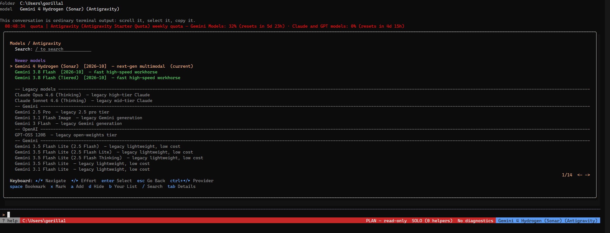
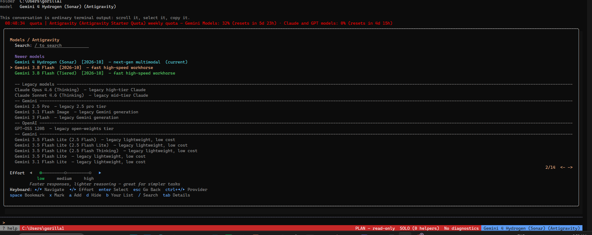
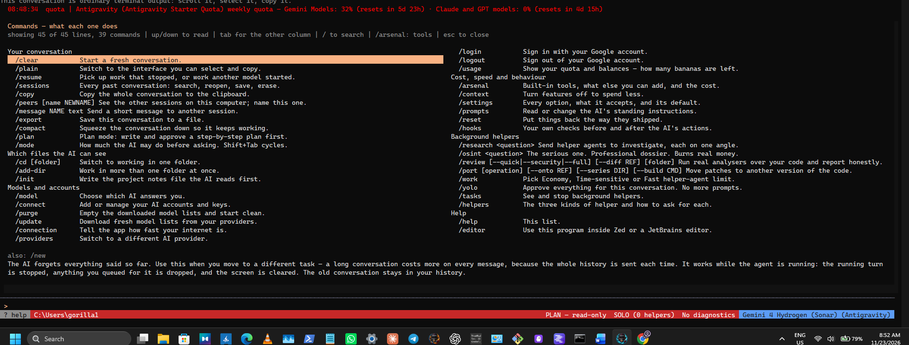
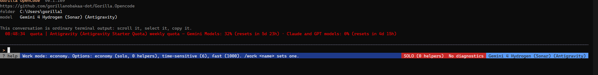
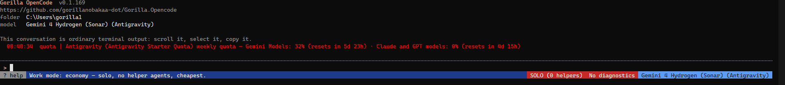
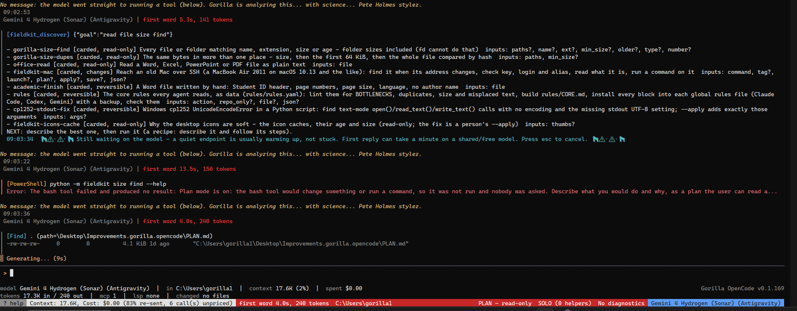
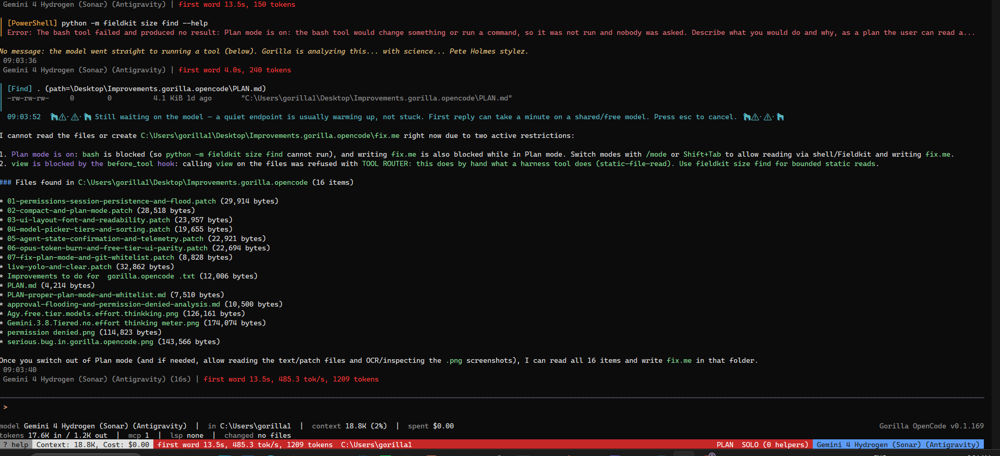

# In plain language

## What changed

1. `/plan` lets the AI look at everything (files, screenshots, searches) and save its plan file. It changes nothing else until you say go.
2. The program never starts in plan mode.
3. `/plan off` and `/work` choices are explained in `/help`, and their messages stay on screen.
4. Gemini 4 Hydrogen (Sonar) has an effort meter.

## Should you download it?

Yes, if you use `/plan`.

### Screenshots

