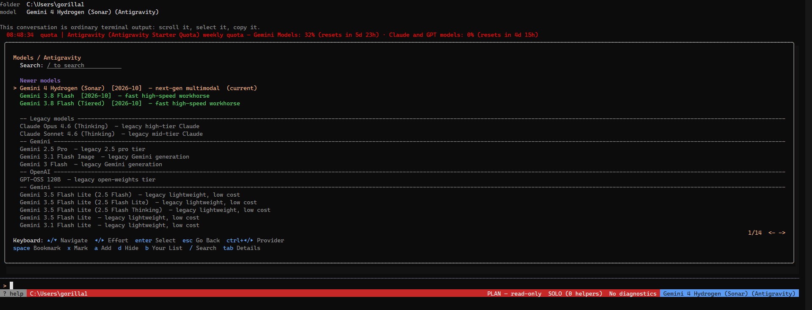
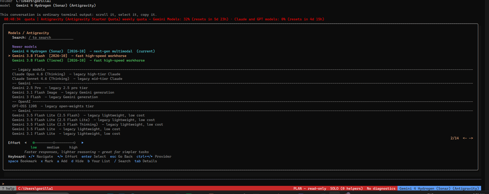
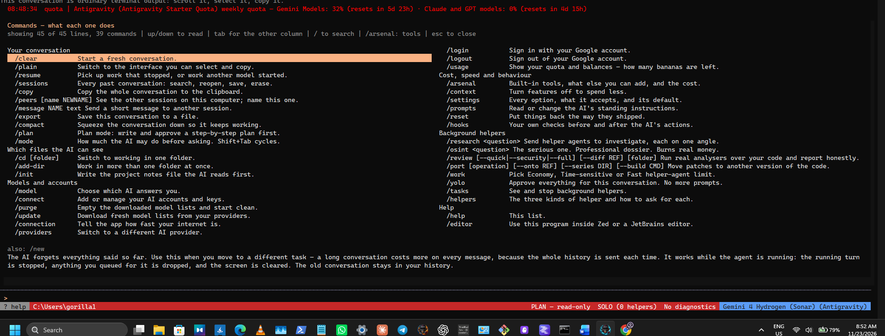
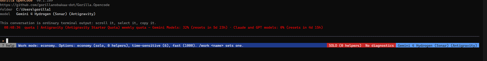
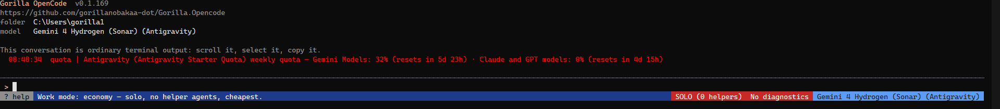
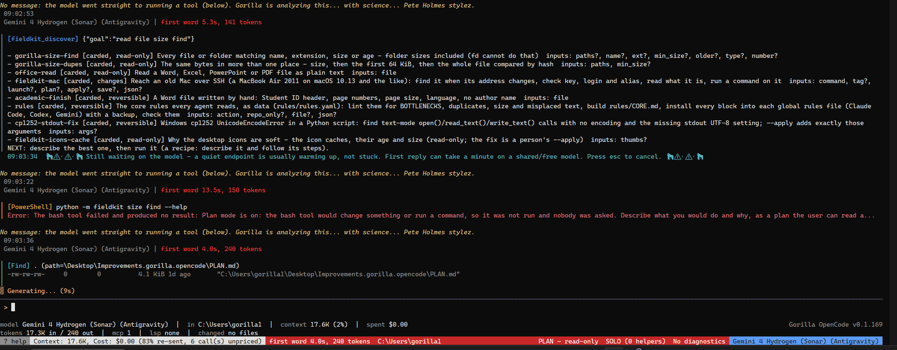
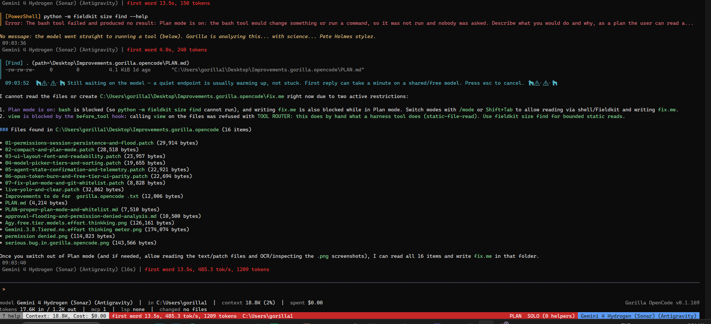

# Gorilla OpenCode 0.1.170: plan mode can read everything and write its plan, Hydrogen effort meter, never starts in plan mode

## What is this program?

Gorilla OpenCode is a terminal coding assistant. It uses the models and
connections you choose, including models running on your computer.

## Should you download this version?

Yes, especially if you use `/plan` or Gemini 4 Hydrogen (Sonar). Update from `0.1.169`.

## Why this matters to you

- **`/plan` works like Gemini, Antigravity, Claude and Codex.** The AI can read
  and inspect freely (files, searches, screenshots and OCR, shell commands after
  you approve them) and can write the plan file (for example `fix.me` in your
  Improvements folder; outside the workspace it asks first). Source code stays
  untouched until you approve.
- **The app never starts in plan mode.** A saved plan mode is reset to ask on start.
- **`/plan off` is in `/help`.** So is how to pick a `/work` level. Both
  messages now stay in the transcript instead of vanishing after about 8 seconds.
- **Gemini 4 Hydrogen (Sonar) has a low / medium / high effort meter**,
  and the choice is really sent to the model.

---
# In plain language: everything in this release

This is the complete explanation, not a summary of one. Nothing below is behind a link.

<!-- plain-language track: in full, on this page -->

## What changed

1. `/plan` lets the AI look at everything (files, screenshots, searches) and save its plan file. It changes nothing else until you say go.
2. The program never starts in plan mode.
3. `/plan off` and `/work` choices are explained in `/help`, and their messages stay on screen.
4. Gemini 4 Hydrogen (Sonar) has an effort meter.

## Should you download it?

Yes, if you use `/plan`.

### Screenshots

---

# For developers: how it works, and how to check it

Written for someone who will audit, fork or change the code. It covers the same release as the plain-language part above; neither is a summary of the other.

<!-- developer track: in full, on this page -->

### Summary

- `internal/permission/mode.go`: plan mode allows reads, lets `bash` take the normal ask path, and allows `write`/`edit` of plan documents (`isPlanDocument`: .md/.txt/.me/.json/.yaml/.yml with plan/roadmap/strategy/rfc/todo/improvement in any path component; outside the workspace it asks). Other tools stay refused.
- `internal/llm/agent/agent.go`: `planModeDirective` reworded to match.
- `internal/config/config.go`: a persisted `plan` mode loads as `ask`.
- `internal/commands/registry.go`, `internal/tui/tui.go`: `/plan off` and `/work` pick help; `ReportInfoEcho` keeps the messages in the transcript.
- `internal/llm/models/models.go`, `internal/llm/provider/antigravity.go`: single-id Gemini Antigravity models get `EffortOptions()`, and `thinkingConfig.thinkingBudget` is sent.

### Security posture

No new network calls, telemetry, providers or dependencies. Plan-mode shell commands and out-of-workspace plan writes still ask.

### Not verified

Live TUI run; live Hydrogen API call; the `view` refusal by the owner's Fieldkit tool-router hook is not changed (hook not weakened).
